  

  
  
  
  
  

---

## Syed Saifullah Shah

**AI Engineer** — BS (CS) Graduate, FAST National University of Computer & Emerging Sciences. I build agentic AI systems, LLM-powered applications and AI-driven automation that turn complex models into reliable, production-ready products.

My work spans the AI application stack: agentic and multi-agent systems, LLM integration, retrieval-augmented generation (RAG) concepts, Model Context Protocol (MCP), prompt engineering and API-driven workflow automation — grounded in a foundation of AWS cloud and DevOps engineering.

## Focus

<table>
<tr><td width="50%" valign="top">

**Agentic AI & LLMs**
- AI agents and multi-agent systems
- LLM-powered assistants and chatbots
- RAG concepts and prompt engineering
- Model Context Protocol (MCP)

</td><td width="50%" valign="top">

**Generative AI Integration**
- Google Gemini, Groq, Claude, ChatGPT
- Grounding, guardrails and fallbacks
- Evidence-based, explainable AI
- AI workflow automation

</td></tr>
<tr><td valign="top">

**AI Application Engineering**
- Python, FastAPI, REST APIs
- TypeScript, React, Next.js
- Full-stack AI application delivery
- MongoDB and relational databases

</td><td valign="top">

**Cloud & DevOps**
- AWS — EC2, S3, VPC, IAM, CloudWatch
- Docker, Kubernetes, Terraform
- CI/CD pipelines and observability
- Linux and deployment

</td></tr>
</table>

## Highlights

- **1.5+ years** of AI engineering experience (Mar 2025 – Sep 2026).
- **165+ automated tests** written, including 123 Python unit tests and 42 end-to-end HTTP assertions.
- **3 AI projects** shipped end to end.
- **GenomeIQ** received formal appreciation from Khyber Pakhtunkhwa government officials, with consideration for regional implementation.

## Projects

### The Buying Studio — *Explainable AI buying decision assistant*
Built a full-stack laptop recommendation platform with deterministic eligibility and preference-based ranking, structured comparisons, and optional Gemini-powered explanations grounded in product evidence. Decision logic is separated from the AI layer, so the application keeps working when the LLM API is unavailable.

`Python` · `FastAPI` · `React` · `TypeScript` · `Google Gemini`

### GenomeIQ — *Final Year Project*
Engineered an end-to-end machine learning system that classifies raw genomic data to streamline gene identification. Full-stack delivery with a Python backend and SVM classifier, a React frontend, and MongoDB for application data. Presented the technical feasibility and social impact to KPK government officials, resulting in formal appreciation and consideration for regional implementation by KPITB.

`Python` · `SVM` · `React` · `MongoDB` · `Machine Learning`

### AI LinkedIn Content Automation
Built a Make.com workflow that researches topics in a chosen niche and generates five AI topic suggestions for human approval. The selected topic is passed to an LLM that writes a structured LinkedIn post with contextual hashtags, then publishes automatically via the LinkedIn API — a reusable, human-in-the-loop content pipeline.

`Make.com` · `AI / LLM` · `LinkedIn API` · `Workflow Automation`

### Earlier DevOps Background — *Kubernetes, CI/CD & Observability*
Migrated a legacy stack onto a GitOps-driven Kubernetes platform with Terraform and Argo CD, designed multi-stage Jenkins pipelines with automated rollbacks, and rolled out a Prometheus, Grafana, Loki and ELK observability stack with alerting runbooks.

`Kubernetes` · `Terraform` · `Argo CD` · `Jenkins` · `Prometheus` · `Grafana`

## Experience

**AI Engineer** — Algouistics Inc., Lahore · *Mar 2025 – Sep 2026*
- Built and integrated AI applications with Python, Generative AI, LLMs and modern AI frameworks.
- Designed agentic AI solutions — AI agents, intelligent workflows and task automation.
- Developed LLM-powered chatbots and knowledge-based assistants with prompt engineering and API integrations.
- Contributed to full-stack AI development with Python, TypeScript, React.js and Next.js, applying MCP and RAG concepts.

**Lab Engineer** — Pak-Austria Fachhochschule, Haripur · *Sep 2023 – Jan 2025*
- Taught Programming Fundamentals and Object-Oriented Programming (OOP) laboratory sessions.
- Guided students through hands-on exercises, debugging and structured problem-solving.

## Stack

`Python` `TypeScript` `JavaScript` `FastAPI` `React` `Next.js` `REST APIs`
`LLMs` `RAG` `MCP` `AI Agents` `Prompt Engineering` `Google Gemini` `Groq` `Claude`
`AWS EC2` `AWS S3` `VPC` `IAM` `Docker` `Kubernetes` `Terraform`
`MongoDB` `MySQL` `DynamoDB` `Amazon RDS`
`Git` `GitHub` `GitLab` `Make.com` `VS Code` `Postman`

## Beyond the Terminal

- Represented FAST-NUCES in national speed programming competitions, including **SOFTEC** and **NASCON**.
- Project concept appreciated by **KPITB** for regional implementation.
- More work and case studies at **[saifullah-shah.netlify.app](https://saifullah-shah.netlify.app)**.

## Connect

| | |
|---|---|
| **Portfolio** | [saifullah-shah.netlify.app](https://saifullah-shah.netlify.app) |
| **GitHub** | [github.com/saifullah-shah](https://github.com/saifullah-shah) |
| **LinkedIn** | [in/syed-saifullah-shah-9702a6154](https://www.linkedin.com/in/syed-saifullah-shah-9702a6154/) |
| **Email** | [tirmezi.17@gmail.com](mailto:tirmezi.17@gmail.com) |
| **Phone** | [+92 302 5733496](tel:+923025733496) |

---

Banner rendered as a self-contained animated SVG — no scripts, no external assets. Dark and light variants are hand-tuned separately for each colour scheme.
